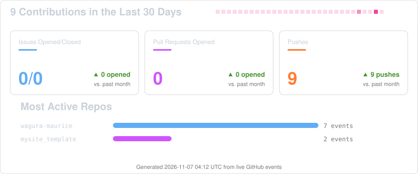

<div align="center">


<p align="center">
  <a href="https://waguramaurice.com/">
    
  </a>
  <a href="https://www.linkedin.com/in/wagura-maurice">
    
  </a>
  <a href="https://github.com/wagura-maurice">
    
  </a>
  <a href="mailto:wagura465@gmail.com">
    
  </a>
</p>

<p align="center">
  
  <a href="https://github.com/wagura-maurice?tab=followers">
    
  </a>
</p>


## 🎯 About Me
</div>


```js
class Developer {

  constructor() {
    this.name = "Maurice Wagura";
    this.role = "Full-Stack Software Engineer";
    this.location = "Nairobi, Kenya";
    this.mindset = "Tailored solutions for real business processes";
  }

  philosophy() {
    return "Understand → Build → Secure → Scale";
  }

}
```
<br clear="right"/>

🚀 Current Focus: Front-end & portal engineering for national-scale government platforms<br>
🌱 Learning Curve: Kubernetes advanced deployments, cloud architecture (AWS · Azure · GCP)<br>
💡 Core Strengths: Portal development, payment integrations (M-Pesa · MTN · Flutterwave), SSO/OAuth 2.0, system administration<br>
🎯 Goal: Shipping secure, accessible products that serve tens of thousands of users


## ⚡ Tech Stack

### 🎨 Frontend
<p align="left">
  
  
  
  
  
  
  
  
  
</p>

### 📱 Mobile
<p align="left">
  
  
  
</p>

### 🧠 Languages
<p align="left">
  
  
  
  
  
  
  
  
  
  
  
  
</p>

### ⚙️ Backend & Databases
<p align="left">
  
  
  
  
  
  
  
  
  
  
  
  
  
</p>

### 🧰 Runtimes, Package & Build Tools
<p align="left">
  
  
  
  
  
  
  
  
</p>
<p align="left"><em>Also daily-driven: Laravel Valet, Wrangler (Cloudflare CLI), gulp, ADB (Android SDK), tmux, jq.</em></p>

### 🛠 DevOps, Tools & Cloud
<p align="left">
  
  
  
  
  
  
  
  
  
  
  
  
  
</p>

<p align="left"><em>Databases also include SQL Server; API work spans REST & GraphQL; Laravel ecosystem includes Livewire & Inertia; edge/serverless work on Cloudflare Workers.</em></p>

### 💳 Payments & Kenyan Integrations
<p align="left">
  
  
  
  
  
  
  
  
</p>
<p align="left">
  
  
</p>

### 🤖 IoT, Bots & Trading
<p align="left">
  
  
  
  
</p>
<p align="left"><em>ESP32/embedded tinkering, Telegram bots, Selenium & Playwright automation, Africa's Talking WebRTC, plus algorithmic trading bots (MetaTrader 5, Binance & Coinbase APIs).</em></p>


## 📌 Featured Projects

<div align="center">

### 🌍 Climate Resilience Service Program (CRSP)

**Public-facing onboarding and registration portal for the Government of Kenya's Climate WorX initiative** — combining urban environmental restoration with employment for tens of thousands of youth nationwide.

**Highlights:**
Mobile-first registration & onboarding • Secure applicant data capture & validation • Admin screening & shortlisting dashboards • REST API integration

**Tech:** JavaScript • Laravel • MySQL • REST APIs • Linux • Nginx

<p>
  <a href="https://crsp.go.ke">
    
  </a>
</p>

---

### 🏛 Access to Government Procurement Opportunities (AGPO)

**Front-end engineering on the Government of Kenya's AGPO portal** — serving youth, women and persons with disabilities seeking public procurement opportunities.

**Highlights:**
Responsive, accessible UI (WCAG-aligned) • UI defect resolution & feature updates • Government web standards compliance

**Tech:** JavaScript • HTML5/CSS3 • Bootstrap

<p>
  <a href="https://agpo.go.ke">
    
  </a>
</p>

---

### 📊 Government Progress Reporting System

**Front-end development for the Presidential Delivery Unit's public reporting portal (delivery.go.ke)** — interactive analytics bringing transparency to government performance data.

**Highlights:**
Interactive data-visualization dashboards • Analytical infographics • Citizen-facing accessible interfaces

**Tech:** JavaScript • HTML5/CSS3 • Data Visualization

---

### ☕ Coffee Value Chain Platform — E4Impact

**Production-grade digital platform for the coffee value chain** — a secure, responsive portal connecting farmers, buyers and administrators across the region.

**Highlights:**
End-to-end platform architecture • GDPR-compliant data handling • Third-party API & vendor integrations • Led a multidisciplinary engineering team

**Tech:** PHP • Laravel • JavaScript • MySQL • Docker

<p>
  <a href="https://e4impactkenya.org/">
    
  </a>
</p>

---

### 💳 Mobile Payment Gateway — EAFF

**Secure mobile money disbursement gateway for the Eastern Africa Farmers Federation** — powering safe payments to farmers across the region.

**Highlights:**
M-Pesa (Safaricom) & MTN mobile money integration • Low-bandwidth mobile-first design • E-extension field tools

**Tech:** PHP • REST APIs • M-Pesa API • MTN API

</div>

<div align="center">

# 📊 GitHub Analytics Dashboard


<p align="center">
  
</p>

<p align="center">
  
  
  
</p>

<p align="center">
  
  
  
</p>

<p align="center">
  
</p>

## 📈 Live Activity (last 30 days)

<p align="center">
  
</p>

## 🐍 Contribution Snake


---

## 🏆 Achievements & Milestones

<table>
<tr>
<td align="center">

<br><strong>Experience</strong>
<br><h2>9+</h2>
<p>Years in Software</p>
</td>
<td align="center">

<br><strong>Platforms</strong>
<br><h2>12+</h2>
<p>Portals & Apps Shipped</p>
</td>
<td align="center">

<br><strong>Certifications</strong>
<br><h2>3</h2>
<p>HackerRank Certified</p>
</td>
<td align="center">

<br><strong>Gov Portals</strong>
<br><h2>3</h2>
<p>National-Scale Systems</p>
</td>
</tr>
</table>

</div>

---
<div align="center">

## 💼 What I Offer

<table>
<tr>
<td align="center" width="33%">

<h3>💻 Portal & Front-end Development</h3>
<p>Responsive, accessible, mobile-first portals and applications with React, Vue, Tailwind and Bootstrap — built to government-grade standards</p>
</td>

<td align="center" width="33%">

<h3>⚙️ Back-end & Integrations</h3>
<p>Robust APIs and secure services with Laravel, Rails, Django and Flask — OAuth 2.0/SSO, REST/GraphQL, and payment gateways (M-Pesa, MTN, Flutterwave)</p>
</td>

<td align="center" width="33%">

<h3>🚀 DevOps & Delivery</h3>
<p>Linux administration, Docker, Nginx, Ansible and CI/CD across AWS, Azure and GCP — plus Agile delivery, UAT support and team leadership</p>
</td>
</tr>
</table>

</div>

---

## 💼 Experience Highlights

| Period | Role | Organization |
|--------|------|--------------|
| 2025 – 2026 | Front-end Developer (CRSP / Climate WorX, GoK) | Leewise Limited |
| 2024 | Trainer / Capacity Building Specialist (NDMA · World Bank) | ISTL / Leewise |
| 2023 | Senior System Manager | E4Impact Foundation |
| 2022 – 2023 | Front-end Developer (AGPO, GoK) | Socialight Media |
| 2019 – 2022 | Senior Software Engineer | Eastern Africa Farmers Federation |
| 2018 – 2019 | Senior Ruby on Rails Developer | Eclectics International |
| 2018 | Back-end Software Developer | Flextech Technologies |
| 2017 – 2018 | Full-stack Web Developer | Wise and Agile Solutions |
| 2016 | Front-end Web Developer | Presidential Delivery Unit, GoK |

---

<div align="center">

## 💬 Recommendations

<table>
<tr>
<td align="center" width="33%">

<h3>Savio Wambugu</h3>
<p><em>Software Engineer at United Nations & Founder, Mt Kenya Hub</em></p>
<p>"Maurice possesses excellent system analysis and development skills. He's an articulate communicator, thinks logically, and develops creative business solutions to complex problems. Detail-oriented and passionate about coding."</p>
</td>

<td align="center" width="33%">

<h3>Alphonce Juma</h3>
<p><em>CEO & Founder, Oracom Group</em></p>
<p>"Maurice proved himself to be an exceptional software engineer. His organizational skills and ability to thrive under pressure stood out."</p>
</td>

<td align="center" width="33%">

<h3>Emily Karechio</h3>
<p><em>Organizational Development Professional & President, MCDF</em></p>
<p>"Maurice's intelligence and diligence are commendable. He consistently delivers superior quality work on time and within budget."</p>
</td>
</tr>
</table>

</div>

---

## 📰 Publications & Features

- 📝 **[Enhancing Transparency, Traceability, and Market Access for Kenyan Coffee](https://e4impactkenya.org/2023/06/21/enhancing-transparency-traceability-and-market-access-for-kenyan-coffee/)** — E4Impact Kenya (June 2023). Byline on the ARABIKA project: a Kenya–Italy collaboration implementing digital registration & traceability in the coffee supply chain.
- 👥 **[E4Impact Entrepreneurship Center Kenya — Team](https://e4impactkenya.org/team/maurice-wagura/)** — Listed as Senior Software Engineer & System Manager.
- 🔬 **[UPSCALE Project](https://www.upscale.biozentrum.uni-wuerzburg.de/Project/Team.aspx)** — University of Würzburg research consortium; EAFF counterpart (Work Package 1).

---

## 🎓 Education & Certifications

- **Bachelor of Business Information Technology** — Kenya Methodist University (2016), Second Class Honours (Upper Division)
- **HackerRank Certifications** — Software Engineer · JavaScript · SQL

---

## 🌐 Connect With Me

<p align="center">
  <a href="https://www.linkedin.com/in/wagura-maurice" target="_blank">
    
  </a>
  <a href="mailto:wagura465@gmail.com">
    
  </a>
  <a href="https://github.com/wagura-maurice" target="_blank">
    
  </a>
  <a href="https://gitlab.com/wagura-maurice" target="_blank">
    
  </a>
  <a href="https://stackoverflow.com/users/5913702/canis-majoris" target="_blank">
    
  </a>
  <a href="https://twitter.com/montanabay39" target="_blank">
    
  </a>
</p>

<p align="center">
  <a href="https://www.mixcloud.com/montanabay39/">
    
  </a>
  <a href="https://audiomack.com/montanabay39">
    
  </a>
  <a href="https://remoteok.com/@montanabay39">
    
  </a>
</p>

---

<p align="center">
  <i>"Build systems you'd trust with a nation's data." 🌌</i>
</p>
**Thanks for visiting! ⭐ Star my repos if you find them interesting!**

</div>
<div align="center">


</div>
